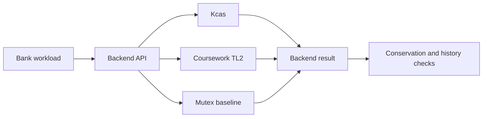
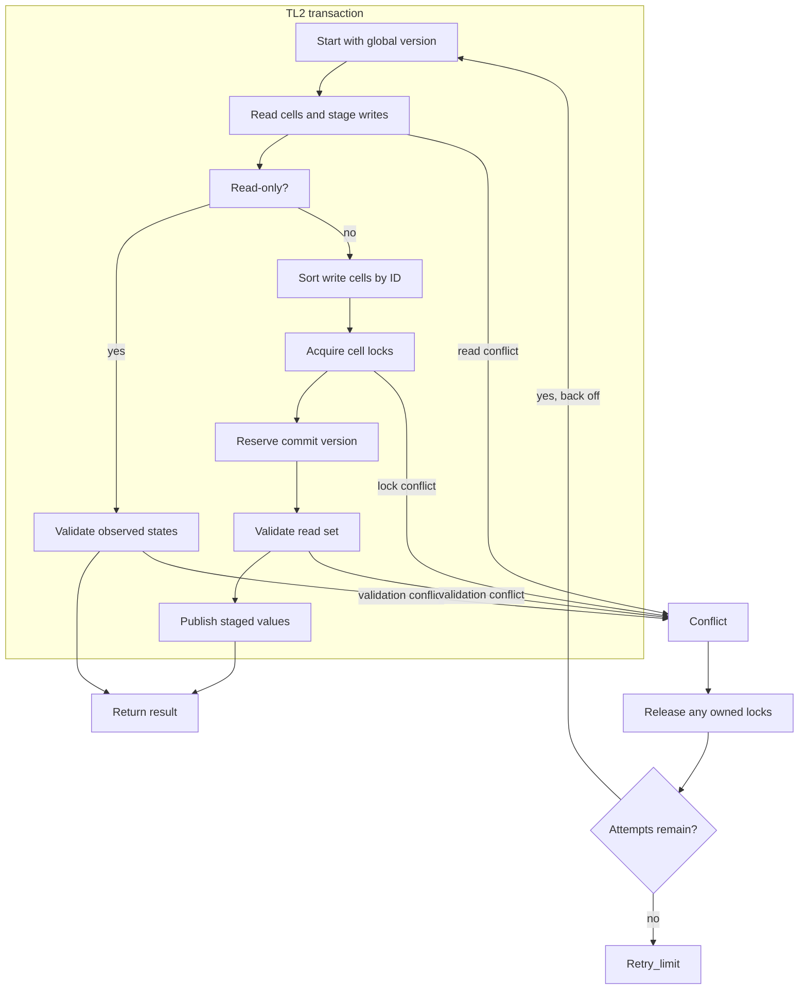

# OCaml transactional memory

This repository pairs the Kcas STM with a small experimental TL2 backend and a bank-transfer workload. It compares two optimistic transaction systems with an explicit mutex baseline on native OCaml 5 domains.

The upstream Kcas implementation, tests, documentation, and history remain intact. See [README.upstream.md](README.upstream.md) for the original guide. Kcas is an ISC-licensed multi-word compare-and-set STM. The source checkout is pinned at `7a83eb3d1900aeefde42a27c2af60e6d8b7b360e`, dated June 14, 2025. Its upstream update cadence is a known limitation of this base.

## Guide

[Architecture and execution guide](#architecture-and-execution-guide) · [Build and test](#build-and-test) · [Experimental TL2 backend](#experimental-tl2-backend) · [Workload comparison](#workload-comparison) · [Coursework and research](#coursework-and-research)

## Architecture and execution guide

This checkout combines inherited Kcas and its upstream tests with a separate OCaml 5 coursework experiment. Kcas remains the general-purpose multi-word [STM](#stm). The added [TL2](#tl2) backend supports integer cells and the bank workload; it does not replace or modify Kcas.



Caption: the same bounded bank workload runs against three independent backends, then its results are checked.



Caption: TL2 records reads and writes, validates read-only attempts directly, and locks write cells in ID order before publishing. Conflicts release owned locks and restart until the caller's retry limit.

| Subsystem | Responsibility and owned state | Source |
| --- | --- | --- |
| Upstream Kcas | General polymorphic compare-and-set STM and its public API. | [`src/`](src/), [`README.upstream.md`](README.upstream.md) |
| TL2 cells and transactions | Integer cell identities, observations, read sets, write sets and commit validation. | [`coursework/src/tl2.ml`](coursework/src/tl2.ml) |
| Workload and backends | Apply bank operations through Kcas, TL2 or a mutex for comparison. | [`coursework/`](coursework/) |
| Deterministic checks | Exercise conflict, rollback, serial history and conservation properties. | [`coursework/test/`](coursework/test/) |
| Verification driver | Runs real-domain checks and retains evidence outside source. | [Verification skill](.agents/skills/verify-ocaml-transactional-memory/SKILL.md) |

Execution journey:

1. The coursework workload creates account cells and chooses Kcas, TL2 or Mutex.
2. A TL2 attempt records the current global version as `start_version`. It adds observed cells to its [read set](#read-set) and stages changes in its [write set](#write-set). Reads see a staged write to the same cell.
3. A read-only attempt validates that each recorded cell still has its observed immutable state. A writing attempt sorts write cells by identity and acquires their locks.
4. TL2 reserves a commit version, validates the full read set, then publishes each staged value with that version.
5. A conflict releases locks owned by the attempt and retries. Reaching the caller's bound raises `Retry_limit`; the API does not promise fairness or completion.

| Choice in the current implementation | Practical rationale | Alternative and cost to reconsider |
| --- | --- | --- |
| Keep TL2 in `coursework/` and Kcas in upstream `src/`. | Preserves upstream APIs, tests and history while allowing a bounded comparison. | Replacing Kcas would lose its general API and invalidate upstream behavior. |
| Represent TL2 cells with integer values and atomic versioned states. | Keeps the experiment's data model narrow and avoids unsafe polymorphic conversion. | Generic values need a different representation and memory-reclamation design. |
| Acquire write locks in cell-ID order. | Gives competing transactions one shared acquisition order. | Another order can change conflict patterns. This implementation aborts on failed atomic claims instead of waiting for locks. |
| Make retries caller-bounded and expose `Retry_limit`. | Callers can observe exhaustion rather than receiving an unbounded loop. | Unbounded retry can hang; a fairness mechanism would need separate evidence. |

These rationales are inferred from the code; they do not claim the original authors' historical motivation.

<a id="stm"></a>

<details><summary>What is software transactional memory?</summary>

Software transactional memory groups reads and writes so a transaction appears to take effect as one consistent operation. Here, a bank transfer reads two account cells and stages both balance changes before commit.
</details>

<a id="tl2"></a>

<details><summary>What is TL2?</summary>

TL2 is a timestamp-based optimistic transaction algorithm. This coursework version samples a global version and validates cell observations before publishing. It is an experiment, not a formal proof or a lock-free implementation.
</details>

<a id="read-set"></a>

<details><summary>What is a read set?</summary>

A read set records each cell value and state observed by an attempt. For example, TL2 compares the current atomic state with the saved state before it commits a transaction that read an account balance.
</details>

<a id="write-set"></a>

<details><summary>What is a write set?</summary>

A write set holds proposed cell values until commit. A transfer stages the debit and credit there; failed validation publishes neither staged value.
</details>

<a id="commit-version"></a>

<details><summary>What is a commit version?</summary>

A commit version is the shared increasing number assigned to a successful TL2 write. Each published cell stores that version, which later attempts use to detect values newer than their starting snapshot.
</details>

<a id="retry-limit"></a>

<details><summary>What is a retry limit?</summary>

The retry limit caps how many transaction attempts the caller permits. When conflicts exhaust it, this implementation raises `Retry_limit`; backoff does not guarantee eventual success.
</details>

<a id="serial-history"></a>

<details><summary>What is a serial history check?</summary>

A serial history check asks whether concurrent operations could have occurred in some valid sequential order. The coursework checker validates a recorded transfer history and rejects an intentionally impossible control history.
</details>

## Build and test

Use OCaml 5 and Dune from the repository's opam packages:

```sh
opam install . --deps-only --with-test
opam lock --keep-local .
opam install . --deps-only --with-test --locked
opam exec -- dune build @all
opam exec -- dune runtest
```

Run the real-domain check and keep its output:

```sh
opam exec -- dune exec coursework/bin/stm_verify.exe -- --doctor
opam exec -- dune exec coursework/bin/stm_verify.exe -- --evidence .agents/runs/local-1
```

The driver checks conservation under 1, 2, and 4 domains with Kcas, TL2, and Mutex. `dune runtest` adds same-cell increments, a barrier-controlled write-skew conflict, validation after commit-version reservation, prepublication failure cleanup, exception rollback, read-your-writes, progress after an aborted transaction, and a concurrent transfer history checked by a separate serial search. The negative control supplies an impossible transfer history and requires the serial checker to reject it.

The [native Ubuntu run](https://github.com/STEVVVU/ocaml-transactional-memory/actions/runs/39721462708) passed the upstream/coursework Dune suite, 5,250 real-domain transfers and the deliberate failure control. Its 135 interleaved benchmark summaries cover 315,000 recorded operation latencies with zero reported operation errors. [Retained verdicts and summaries](docs/evidence/linux-39721462708/) include the raw benchmark hash. These are bounded synthetic measurements, without a general speedup claim. The Windows workspace has no native OCaml toolchain.

## Experimental TL2 backend

`coursework/src/tl2.ml` implements integer cells with an atomic state containing either an unlocked value and version or a transaction lock owner. A transaction samples the global version, records a read set, stages writes, acquires write locks in cell-ID order, reserves a commit version, validates the read set, and publishes the staged values. It retries conflicts up to a caller-set bound, uses the existing randomized exponential `Backoff` library between failed attempts, and reports exhaustion as `Retry_limit`. Callers must handle exhaustion; backoff does not guarantee fairness or completion under arbitrary contention.

The fixed-width integer API keeps the write and read logs typed without `Obj.magic`. User transaction functions can run again after conflicts, so they must not perform I/O or other external side effects. Only mutations staged through `Tl2.write` join a transaction. This implementation is a teaching experiment. It does not replace Kcas, provide a formal proof of TL2, or claim lock-free progress, fairness, allocator safety, or general OCaml data support.

Read-only commits validate recorded immutable cell-state identities directly.
Transactions with staged writes retain sorted lock acquisition, commit-version
reservation, validation and publication.

## Workload comparison

The benchmark runs disjoint, contended, and read-heavy bank operations through Kcas, TL2, and Mutex. It warms each workload, rotates backend order across five trials, keeps the operation schedule deterministic, and records each operation's latency plus summary counts using Mtime's monotonic OS clock. The CSV is evidence, not a speedup claim. Run it after creating an evidence directory:

```sh
opam exec -- dune exec --profile release coursework/bench/stm_bench.exe -- --output .agents/runs/local-1/bench.csv
```

## Longer native evidence

The original longer matrix [run 39728173211](https://github.com/STEVVVU/ocaml-transactional-memory/actions/runs/39728173211)
hit its 900-second limit in the 8192-account tier. Its completed rows are retained;
it is an incomplete campaign. TL2's completed one-domain read-heavy trials took
55.49..56.65 seconds for 20000 operations, with zero retries and about nine
billion allocated words per trial. No full-domain comparison is claimed from
that failed run.

The established `multicore-bench` 0.1.7 fixture then measured checked read-only
snapshots of the same 8192-account footprint in [run 39733269312](https://github.com/STEVVVU/ocaml-transactional-memory/actions/runs/39733269312).
Ubuntu 24.04, OCaml 5.3.0 Release and an AMD EPYC 9V45 VM reporting four logical
CPUs on two cores produced the following aggregate snapshots/second:

| Domains | Kcas | TL2 | Mutex |
| ---: | ---: | ---: | ---: |
| 1 | 9145 (8942..9509) | 474 (456..490) | 35836 (30581..36565) |
| 2 | 16396 (16104..16732) | 806 (767..874) | 49310 (34586..51862) |
| 4 | 18549 (17725..18624) | 1148 (1119..1181) | 40282 (38885..41311) |

Values are medians of five framework-pass medians, with the full range of pass
medians. Each pass randomizes suites and records five runs after three warmups,
with 100 checked snapshots per domain per run. Native JSON preserves each pass's
best/mean/median/SD/run count; individual inner timings are not emitted by this
framework. This read-only fixture supplements the mixed workload and is not a
transaction-abort or fairness measurement. Mutex's 100-snapshot batches are
short (roughly 2.7..10 ms per domain); treat those controls as provisional
until longer confirmation. Framework CPU/RSS/GC deltas were not collected.
[All 90 native aggregate metrics,
summaries, commands and raw hashes](docs/evidence/linux-39733269312/) are retained.

A [separate successful profile](docs/evidence/linux-39733272376/) confirmed
avoidable read-set sorting before TL2's read-only validation. Exclusive sorting
and comparator instructions account for 12.65% of its full diagnostic process,
which also includes all backends, setup and final correctness checks. This is
not a native wall-time percentage. Independent review approved a narrow
read-only validation fast path, and the matched native run below passed.

```sh
opam exec -- dune build --profile release coursework/bench/stm_framework.exe
mkdir -p .agents/runs/fresh-framework
for repeat in 1 2 3 4 5; do
  timeout 180 _build/default/coursework/bench/stm_framework.exe > .agents/runs/fresh-framework/framework-$repeat.json
done
```

The maintained fixture now uses 1000 snapshots per domain to lengthen the
Mutex controls. The workflow's `framework=true` comparison builds current
source and frozen `6ecf556`, overlays that identical maintained fixture onto
the archived baseline, and alternates five whole passes per build. It records
source/fixture/binary hashes, resources and exit receipts. This is an explicit
workload revision: the table above remains the original 100-snapshot baseline
and cannot be compared directly with the 1000-snapshot results below.

The [matched run 39735999046](https://github.com/STEVVVU/ocaml-transactional-memory/actions/runs/39735999046)
compared frozen `6ecf556` against `51c48e5` on one Ubuntu 24.04/OCaml 5.3.0
Release runner, an AMD EPYC 9V74 VM reporting four logical CPUs on two cores.
Both builds used the identical 8192-account, 1000-snapshot fixture. Five
alternating whole passes, each with three warmups and five native runs, gave
aggregate TL2 snapshots/second (median of pass medians; full pass-median range):

| Domains | Frozen TL2 | Direct read-only validation | Ratio |
| ---: | ---: | ---: | ---: |
| 1 | 378.2 (359.1..380.4) | 935.2 (926.8..938.0) | 2.47× |
| 2 | 643.6 (629.3..663.8) | 1524.4 (1517.8..1535.4) | 2.37× |
| 4 | 862.8 (851.1..875.1) | 1963.6 (1913.2..1993.4) | 2.28× |

Both source suites passed, including stale/same-value read rejection and the
existing concurrent history oracle. The native driver passed 5250 transfers;
the separate short mixed campaign completed 315000 operations with zero errors.
All ten matched processes and owned cleanup passed. Full-pass wall medians
fell from 90.95 (90.13..91.89) to 42.93 (42.35..43.04) seconds, while peak RSS
medians rose from 39396 (37272..43796) to 50104 (49120..50712) KiB. These
resources include every backend, warmups, domain creation and measurement.

All controls are retained: unchanged Mutex medians were about 9% lower at
one/two domains, with no cause isolated; Kcas medians differed by 0.3..2.4%.
The improvement claim is specific to TL2's checked read-only footprint.
[All 180 native aggregate metrics, every control, resources, exact commands,
receipts and raw hashes](docs/evidence/linux-39735999046/) are retained.
The earlier longer mixed/latency/retry sweep was incomplete. The
[failed rerun 39739124466](docs/evidence/linux-39739124466/) finished all 135
trial summaries in each smaller tier and 132 of 135 in
the large tier before its 900-second cap, with zero errors in completed rows.
The final four completed large TL2 read-heavy trials each took 86.8–91.7
seconds; their measured regions already consumed 807.6 seconds across the tier.
The unchanged workload now has a 1200-second tier cap, with GNU time outside
the timeout so failed runs also retain resource costs.

The unchanged full matrix then completed in [run 39741981142](https://github.com/STEVVVU/ocaml-transactional-memory/actions/runs/39741981142)
at `995cb12`, Ubuntu 24.04/OCaml 5.3.0 Release, AMD EPYC 7763 VM (four logical
CPUs/two cores). All 405 trial summaries form 81 complete five-trial groups:
18900000 measured successes, zero reported errors, and 189000 stride-100 raw
latencies. Native tests/history checks, positive/negative driver receipts and
owned-domain cleanup passed. The maintained validator's complete summary was
independently reproduced. Reproduce through the same helper:

```sh
bash coursework/scripts/verify.sh --metrics fresh-long-mixed
```

At 8192 shared accounts, read-heavy aggregate operations/second are medians
with the full range of five trials:

| Domains | Kcas | TL2 | Mutex |
| ---: | ---: | ---: | ---: |
| 1 | 4930 (4909..4993) | 750 (745..775) | 25463 (25025..26139) |
| 2 | 8639 (8577..8730) | 1185 (1174..1204) | 26597 (25616..27073) |
| 4 | 4714 (4706..4763) | 1009 (995..1021) | 21436 (21143..22030) |

All three slow at four domains versus two in this mixed workload. TL2 remains
slower than both controls. Its four-domain p99 is 14.280 (13.874..14.468) ms,
retry events 21651 (21490..21782), and allocations 11.823 (11.804..11.839)
billion words per trial. The per-transaction 100-attempt limit is unchanged;
zero errors includes no reported exhaustion. The large tier took 926.80 wall
seconds, 2456.61 CPU seconds and 65968 KiB peak RSS, including every backend,
warmups, domain creation and output. The smaller tiers took 4.14/9.31 seconds
and 26896/28520 KiB peak RSS. These are whole-tier resource receipts.

[Every cell and original trial, full p50/p95/p99 and retry ranges,
resource/cleanup receipts, environment, exact commands and raw/source hashes](docs/evidence/linux-39741981142/)
are retained. 68 groups contain a trial below 0.1 seconds and remain flagged;
no throughput claim rests on these short rows. Summary quantiles use all
operations, while raw latency data retain every 100th operation. Kcas aborts,
per-operation retry maxima and fairness are unmeasured. This run's host differs
from the failed sweep and the controlled read-only pair: completing a larger
timeout budget is coverage, not a runtime gain or a causal cross-host comparison.

## Coursework and research

The workload follows the multicore transactional-memory topic in the [OCaml STM course project](https://vraajkum.github.io/ocaml-stm-webpage/). That project compares optimistic and pessimistic STM behavior on shared data structures. Its student implementation is not included here.

The separate TL2 implementation follows the mechanism described in Dice, Shalev, and Shavit, [Transactional Locking II](https://people.csail.mit.edu/shanir/publications/Transactional_Locking.pdf), DISC 2006. The paper's validation, versioning, and write-lock protocol guide the experiment. Bounded tests here do not reproduce the paper's full evaluation or establish its formal properties.

The inherited Windows workflow is archived byte-for-byte outside GitHub's active workflow directory; upstream scripts remain preserved. The added coursework workflow runs the upstream and coursework Dune tests on OCaml 5, captures package versions and lock files, exercises the driver, and preserves run evidence as an artifact.
