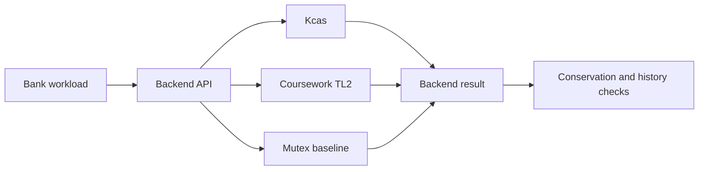
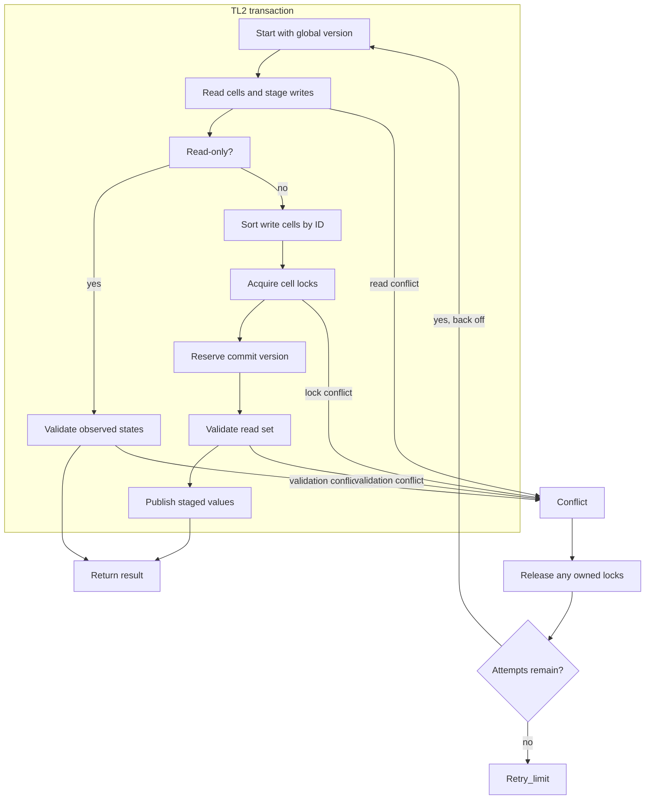

# OCaml transactional memory

This repository pairs the Kcas STM with a small experimental TL2 backend and a bank-transfer workload. It compares two optimistic transaction systems with an explicit mutex baseline on native OCaml 5 domains.

The upstream Kcas implementation, tests, documentation, and history remain intact. See [README.upstream.md](README.upstream.md) for the original guide. Kcas is an ISC-licensed multi-word compare-and-set STM. The source checkout is pinned at `7a83eb3d1900aeefde42a27c2af60e6d8b7b360e`, dated June 14, 2025. Its upstream update cadence is a known limitation of this base.

## Guide

[Implementation techniques](#implementation-techniques) ·
[Architecture and execution guide](#architecture-and-execution-guide) · [Build and test](#build-and-test) · [Experimental TL2 backend](#experimental-tl2-backend) · [Workload comparison](#workload-comparison) · [Coursework and research](#coursework-and-research)

## Architecture and execution guide

This checkout combines inherited Kcas and its upstream tests with a separate OCaml 5 coursework experiment. Kcas remains the general-purpose multi-word [STM](#stm). The added [TL2](#tl2) backend supports integer cells and the bank workload; it does not replace or modify Kcas.



Caption: the same bounded bank workload runs against three independent backends, then its results are checked.



Caption: TL2 records reads and writes, validates read-only attempts directly, and locks write cells in ID order before publishing. Conflicts release owned locks and restart until the caller's retry limit.

| Subsystem | Responsibility and owned state | Source |
| --- | --- | --- |
| Upstream Kcas | General polymorphic compare-and-set STM and its public API. | [`src/`](src/), [`README.upstream.md`](README.upstream.md) |
| TL2 cells and transactions | Integer cell identities, observations, read sets, write sets and commit validation. | [`coursework/src/tl2.ml`](coursework/src/tl2.ml) |
| Workload and backends | Apply bank operations through Kcas, TL2 or a mutex for comparison. | [`coursework/`](coursework/) |
| Deterministic checks | Exercise conflict, rollback, serial history and conservation properties. | [`coursework/test/`](coursework/test/) |
| Verification driver | Runs real-domain checks and retains evidence outside source. | [Verification skill](.agents/skills/verify-ocaml-transactional-memory/SKILL.md) |

Execution journey:

1. The coursework workload creates account cells and chooses Kcas, TL2 or Mutex.
2. A TL2 attempt records the current global version as `start_version`. It adds observed cells to its [read set](#read-set) and stages changes in its [write set](#write-set). Reads see a staged write to the same cell.
3. A read-only attempt validates that each recorded cell still has its observed immutable state. A writing attempt sorts write cells by identity and acquires their locks.
4. TL2 reserves a commit version, validates the full read set, then publishes each staged value with that version.
5. A conflict releases locks owned by the attempt and retries. Reaching the caller's bound raises `Retry_limit`; the API does not promise fairness or completion.

| Choice in the current implementation | Practical rationale | Alternative and cost to reconsider |
| --- | --- | --- |
| Keep TL2 in `coursework/` and Kcas in upstream `src/`. | Preserves upstream APIs, tests and history while allowing a bounded comparison. | Replacing Kcas would lose its general API and invalidate upstream behavior. |
| Represent TL2 cells with integer values and atomic versioned states. | Keeps the experiment's data model narrow and avoids unsafe polymorphic conversion. | Generic values need a different representation and memory-reclamation design. |
| Acquire write locks in cell-ID order. | Gives competing transactions one shared acquisition order. | Another order can change conflict patterns. This implementation aborts on failed atomic claims instead of waiting for locks. |
| Make retries caller-bounded and expose `Retry_limit`. | Callers can observe exhaustion rather than receiving an unbounded loop. | Unbounded retry can hang; a fairness mechanism would need separate evidence. |

These rationales are inferred from the code; they do not claim the original authors' historical motivation.

<a id="stm"></a>

<details><summary>What is software transactional memory?</summary>

Software transactional memory groups reads and writes so a transaction appears to take effect as one consistent operation. Here, a bank transfer reads two account cells and stages both balance changes before commit.
</details>

<a id="tl2"></a>

<details><summary>What is TL2?</summary>

TL2 is a timestamp-based optimistic transaction algorithm. This coursework version samples a global version and validates cell observations before publishing. It is an experiment, not a formal proof or a lock-free implementation.
</details>

<a id="read-set"></a>

<details><summary>What is a read set?</summary>

A read set records each cell value and state observed by an attempt. For example, TL2 compares the current atomic state with the saved state before it commits a transaction that read an account balance.
</details>

<a id="write-set"></a>

<details><summary>What is a write set?</summary>

A write set holds proposed cell values until commit. A transfer stages the debit and credit there; failed validation publishes neither staged value.
</details>

<a id="commit-version"></a>

<details><summary>What is a commit version?</summary>

A commit version is the shared increasing number assigned to a successful TL2 write. Each published cell stores that version, which later attempts use to detect values newer than their starting snapshot.
</details>

<a id="retry-limit"></a>

<details><summary>What is a retry limit?</summary>

The retry limit caps how many transaction attempts the caller permits. When conflicts exhaust it, this implementation raises `Retry_limit`; backoff does not guarantee eventual success.
</details>

<a id="serial-history"></a>

<details><summary>What is a serial history check?</summary>

A serial history check asks whether concurrent operations could have occurred in some valid sequential order. The coursework checker validates a recorded transfer history and rejects an intentionally impossible control history.
</details>

## Build and test

Use OCaml 5 and Dune from the repository's opam packages:

```sh
opam install . --deps-only --with-test
opam lock --keep-local .
opam install . --deps-only --with-test --locked
opam exec -- dune build @all
opam exec -- dune runtest
```

Run the real-domain check and keep its output:

```sh
opam exec -- dune exec coursework/bin/stm_verify.exe -- --doctor
opam exec -- dune exec coursework/bin/stm_verify.exe -- --evidence .agents/runs/local-1
```

The driver checks conservation under 1, 2, and 4 domains with Kcas, TL2, and Mutex. `dune runtest` adds same-cell increments, a barrier-controlled write-skew conflict, validation after commit-version reservation, prepublication failure cleanup, exception rollback, read-your-writes, progress after an aborted transaction, and a concurrent transfer history checked by a separate serial search. The negative control supplies an impossible transfer history and requires the serial checker to reject it.

The [native Ubuntu run](https://github.com/STEVVVU/ocaml-transactional-memory/actions/runs/39721462708) passed the upstream/coursework Dune suite, 5,250 real-domain transfers and the deliberate failure control. Its 135 interleaved benchmark summaries cover 315,000 recorded operation latencies with zero reported operation errors. [Retained verdicts and summaries](docs/evidence/linux-39721462708/) include the raw benchmark hash. These are bounded synthetic measurements, without a general speedup claim. The Windows workspace has no native OCaml toolchain.

## Experimental TL2 backend

`coursework/src/tl2.ml` implements integer cells with an atomic state containing either an unlocked value and version or a transaction lock owner. A transaction samples the global version, records a read set, stages writes, acquires write locks in cell-ID order, reserves a commit version, validates the read set, and publishes the staged values. It retries conflicts up to a caller-set bound, uses the existing randomized exponential `Backoff` library between failed attempts, and reports exhaustion as `Retry_limit`. Callers must handle exhaustion; backoff does not guarantee fairness or completion under arbitrary contention.

The fixed-width integer API keeps the write and read logs typed without `Obj.magic`. User transaction functions can run again after conflicts, so they must not perform I/O or other external side effects. Only mutations staged through `Tl2.write` join a transaction. This implementation is a teaching experiment. It does not replace Kcas, provide a formal proof of TL2, or claim lock-free progress, fairness, allocator safety, or general OCaml data support.

Read-only commits validate recorded immutable cell-state identities directly.
Transactions with staged writes retain sorted lock acquisition, commit-version
reservation, validation and publication.

## Workload comparison

The benchmark runs disjoint, contended, and read-heavy bank operations through Kcas, TL2, and Mutex. It warms each workload, rotates backend order across five trials, keeps the operation schedule deterministic, and records each operation's latency plus summary counts using Mtime's monotonic OS clock. The CSV is evidence, not a speedup claim. Run it after creating an evidence directory:

```sh
opam exec -- dune exec --profile release coursework/bench/stm_bench.exe -- --output .agents/runs/local-1/bench.csv
```

## Longer native evidence

The original longer matrix [run 39728173211](https://github.com/STEVVVU/ocaml-transactional-memory/actions/runs/39728173211)
hit its 900-second limit in the 8192-account tier. Its completed rows are retained;
it is an incomplete campaign. TL2's completed one-domain read-heavy trials took
55.49..56.65 seconds for 20000 operations, with zero retries and about nine
billion allocated words per trial. No full-domain comparison is claimed from
that failed run.

The established `multicore-bench` 0.1.7 fixture then measured checked read-only
snapshots of the same 8192-account footprint in [run 39733269312](https://github.com/STEVVVU/ocaml-transactional-memory/actions/runs/39733269312).
Ubuntu 24.04, OCaml 5.3.0 Release and an AMD EPYC 9V45 VM reporting four logical
CPUs on two cores produced the following aggregate snapshots/second:

| Domains | Kcas | TL2 | Mutex |
| ---: | ---: | ---: | ---: |
| 1 | 9145 (8942..9509) | 474 (456..490) | 35836 (30581..36565) |
| 2 | 16396 (16104..16732) | 806 (767..874) | 49310 (34586..51862) |
| 4 | 18549 (17725..18624) | 1148 (1119..1181) | 40282 (38885..41311) |

Values are medians of five framework-pass medians, with the full range of pass
medians. Each pass randomizes suites and records five runs after three warmups,
with 100 checked snapshots per domain per run. Native JSON preserves each pass's
best/mean/median/SD/run count; individual inner timings are not emitted by this
framework. This read-only fixture supplements the mixed workload and is not a
transaction-abort or fairness measurement. Mutex's 100-snapshot batches are
short (roughly 2.7..10 ms per domain); treat those controls as provisional
until longer confirmation. Framework CPU/RSS/GC deltas were not collected.
[All 90 native aggregate metrics,
summaries, commands and raw hashes](docs/evidence/linux-39733269312/) are retained.

A [separate successful profile](docs/evidence/linux-39733272376/) confirmed
avoidable read-set sorting before TL2's read-only validation. Exclusive sorting
and comparator instructions account for 12.65% of its full diagnostic process,
which also includes all backends, setup and final correctness checks. This is
not a native wall-time percentage. Independent review approved a narrow
read-only validation fast path, and the matched native run below passed.

```sh
opam exec -- dune build --profile release coursework/bench/stm_framework.exe
mkdir -p .agents/runs/fresh-framework
for repeat in 1 2 3 4 5; do
  timeout 180 _build/default/coursework/bench/stm_framework.exe > .agents/runs/fresh-framework/framework-$repeat.json
done
```

The maintained fixture now uses 1000 snapshots per domain to lengthen the
Mutex controls. The workflow's `framework=true` comparison builds current
source and frozen `6ecf556`, overlays that identical maintained fixture onto
the archived baseline, and alternates five whole passes per build. It records
source/fixture/binary hashes, resources and exit receipts. This is an explicit
workload revision: the table above remains the original 100-snapshot baseline
and cannot be compared directly with the 1000-snapshot results below.

The [matched run 39735999046](https://github.com/STEVVVU/ocaml-transactional-memory/actions/runs/39735999046)
compared frozen `6ecf556` against `51c48e5` on one Ubuntu 24.04/OCaml 5.3.0
Release runner, an AMD EPYC 9V74 VM reporting four logical CPUs on two cores.
Both builds used the identical 8192-account, 1000-snapshot fixture. Five
alternating whole passes, each with three warmups and five native runs, gave
aggregate TL2 snapshots/second (median of pass medians; full pass-median range):

| Domains | Frozen TL2 | Direct read-only validation | Ratio |
| ---: | ---: | ---: | ---: |
| 1 | 378.2 (359.1..380.4) | 935.2 (926.8..938.0) | 2.47× |
| 2 | 643.6 (629.3..663.8) | 1524.4 (1517.8..1535.4) | 2.37× |
| 4 | 862.8 (851.1..875.1) | 1963.6 (1913.2..1993.4) | 2.28× |

Both source suites passed, including stale/same-value read rejection and the
existing concurrent history oracle. The native driver passed 5250 transfers;
the separate short mixed campaign completed 315000 operations with zero errors.
All ten matched processes and owned cleanup passed. Full-pass wall medians
fell from 90.95 (90.13..91.89) to 42.93 (42.35..43.04) seconds, while peak RSS
medians rose from 39396 (37272..43796) to 50104 (49120..50712) KiB. These
resources include every backend, warmups, domain creation and measurement.

All controls are retained: unchanged Mutex medians were about 9% lower at
one/two domains, with no cause isolated; Kcas medians differed by 0.3..2.4%.
The improvement claim is specific to TL2's checked read-only footprint.
[All 180 native aggregate metrics, every control, resources, exact commands,
receipts and raw hashes](docs/evidence/linux-39735999046/) are retained.
The earlier longer mixed/latency/retry sweep was incomplete. The
[failed rerun 39739124466](docs/evidence/linux-39739124466/) finished all 135
trial summaries in each smaller tier and 132 of 135 in
the large tier before its 900-second cap, with zero errors in completed rows.
The final four completed large TL2 read-heavy trials each took 86.8–91.7
seconds; their measured regions already consumed 807.6 seconds across the tier.
The unchanged workload now has a 1200-second tier cap, with GNU time outside
the timeout so failed runs also retain resource costs.

The unchanged full matrix then completed in [run 39741981142](https://github.com/STEVVVU/ocaml-transactional-memory/actions/runs/39741981142)
at `995cb12`, Ubuntu 24.04/OCaml 5.3.0 Release, AMD EPYC 7763 VM (four logical
CPUs/two cores). All 405 trial summaries form 81 complete five-trial groups:
18900000 measured successes, zero reported errors, and 189000 stride-100 raw
latencies. Native tests/history checks, positive/negative driver receipts and
owned-domain cleanup passed. The maintained validator's complete summary was
independently reproduced. Reproduce through the same helper:

```sh
bash coursework/scripts/verify.sh --metrics fresh-long-mixed
```

At 8192 shared accounts, read-heavy aggregate operations/second are medians
with the full range of five trials:

| Domains | Kcas | TL2 | Mutex |
| ---: | ---: | ---: | ---: |
| 1 | 4930 (4909..4993) | 750 (745..775) | 25463 (25025..26139) |
| 2 | 8639 (8577..8730) | 1185 (1174..1204) | 26597 (25616..27073) |
| 4 | 4714 (4706..4763) | 1009 (995..1021) | 21436 (21143..22030) |

All three slow at four domains versus two in this mixed workload. TL2 remains
slower than both controls. Its four-domain p99 is 14.280 (13.874..14.468) ms,
retry events 21651 (21490..21782), and allocations 11.823 (11.804..11.839)
billion words per trial. The per-transaction 100-attempt limit is unchanged;
zero errors includes no reported exhaustion. The large tier took 926.80 wall
seconds, 2456.61 CPU seconds and 65968 KiB peak RSS, including every backend,
warmups, domain creation and output. The smaller tiers took 4.14/9.31 seconds
and 26896/28520 KiB peak RSS. These are whole-tier resource receipts.

[Every cell and original trial, full p50/p95/p99 and retry ranges,
resource/cleanup receipts, environment, exact commands and raw/source hashes](docs/evidence/linux-39741981142/)
are retained. 68 groups contain a trial below 0.1 seconds and remain flagged;
no throughput claim rests on these short rows. Summary quantiles use all
operations, while raw latency data retain every 100th operation. Kcas aborts,
per-operation retry maxima and fairness are unmeasured. This run's host differs
from the failed sweep and the controlled read-only pair: completing a larger
timeout budget is coverage, not a runtime gain or a causal cross-host comparison.

## Coursework and research

The workload follows the multicore transactional-memory topic in the [OCaml STM course project](https://vraajkum.github.io/ocaml-stm-webpage/). That project compares optimistic and pessimistic STM behavior on shared data structures. Its student implementation is not included here.

The separate TL2 implementation follows the mechanism described in Dice, Shalev, and Shavit, [Transactional Locking II](https://people.csail.mit.edu/shanir/publications/Transactional_Locking.pdf), DISC 2006. The paper's validation, versioning, and write-lock protocol guide the experiment. Bounded tests here do not reproduce the paper's full evaluation or establish its formal properties.

The inherited Windows workflow is archived byte-for-byte outside GitHub's active workflow directory; upstream scripts remain preserved. The added coursework workflow runs the upstream and coursework Dune tests on OCaml 5, captures package versions and lock files, exercises the driver, and preserves run evidence as an artifact.
## Implementation techniques

These cards cover the active coursework transaction paths, their Kcas and mutex comparison backends, and the verification and benchmark methods. Kcas remains a separate inherited backend. Rationale describes current code and does not claim historical author intent.

| Subsystem | Technique cards | Source |
| --- | --- | --- |
| TL2 transaction engine | [bounded atomic identities](#technique-bounded-atomic-identities), [optimistic versioned reads and snapshot validation](#technique-optimistic-versioned-reads), [write buffering](#technique-tl2-write-buffer), [sorted CAS write locking](#technique-ordered-cas-locking), [global commit clock](#technique-global-commit-clock), [direct read-only validation](#technique-read-only-fast-path), [publication and lock rollback](#technique-tl2-publication-rollback), [bounded retry](#technique-tl2-rollback-retry) | [`coursework/src/tl2.ml`](coursework/src/tl2.ml) |
| Bank adapters and baselines | [Kcas multi-word commit](#technique-kcas-multiword-commit), [coarse mutex baseline](#technique-coarse-mutex-baseline), [shared bank invariant](#technique-shared-bank-invariant) | [`coursework/src/bank.ml`](coursework/src/bank.ml), [`src/kcas/kcas.ml`](src/kcas/kcas.ml) |
| Concurrency and history tests | [Real-time serial-history search](#technique-realtime-serial-history-oracle) | [`coursework/test/test_tl2.ml`](coursework/test/test_tl2.ml) |
| Native verification | [Domain verification and verdict receipts](#technique-native-domain-verification) | [`coursework/bin/stm_verify.ml`](coursework/bin/stm_verify.ml) |
| Mixed benchmark | [Controlled contention workloads](#technique-controlled-contention-workloads), [synchronized rotated trials](#technique-synchronized-rotated-measurement) | [`coursework/bench/stm_bench.ml`](coursework/bench/stm_bench.ml) |
| Read-only and historical comparison | [Framework snapshot comparison](#technique-framework-readonly-comparison), [frozen-source fixture comparison](#technique-frozen-source-comparison) | [`coursework/bench/stm_framework.ml`](coursework/bench/stm_framework.ml), [workflow](.github/workflows/coursework.yml), [retained run](docs/evidence/linux-39741981142/README.md) |

<a id="technique-bounded-atomic-identities"></a>

<details>
<summary>Bounded atomic identity allocation</summary>

**Mechanism.** `fresh_id` reads the shared next-ID counter and uses compare-and-set to claim the next integer. It tries at most 64 times. Cell creation uses an ID for stable ordering, and each transaction uses a fresh ID as its lock-owner token.

**Example.** If two domains read the same counter value, only the successful compare-and-set receives that ID. The loser reads the updated counter on its next attempt.

**Why here.** Distinct IDs let commit sort cells and let unlock verify the transaction still owns a lock.

**Tradeoffs.** The counter is shared, contention can exhaust the bound, and reaching `max_int` raises `Identity_overflow` instead of wrapping.

**Code and ownership.** [`fresh_id`](coursework/src/tl2.ml#L24), used by [`create`](coursework/src/tl2.ml#L34) and [`attempt_with_hooks`](coursework/src/tl2.ml#L150). Extension.

</details>

<a id="technique-optimistic-versioned-reads"></a>

<details>
<summary>Optimistic versioned reads</summary>

**Mechanism.** A transaction captures the global start version. On first read of a cell, it rejects locks and versions newer than its start, then loads the cell again and retries if the atomic state changed. Repeated reads use the stored observation; reads also see staged writes.

**Example.** `read tx cell` returns the pending value when present, otherwise the observed value.

**Why here.** The bank workload needs a compact optimistic backend for integer cells.

**Tradeoffs.** A racing update aborts the transaction. Observation retries are bounded, so contention can surface as a conflict.

**Code and ownership.** [`coursework/src/tl2.ml`](coursework/src/tl2.ml#L36) `observe` and `read`. Extension.

</details>

<a id="technique-ordered-cas-locking"></a>

<details>
<summary>Ordered CAS locking and validation</summary>

**Mechanism.** Commit sorts observed cells by ID, filters write cells, and uses compare-and-set to replace each observed state with an owner lock. It reserves a commit version, validates the complete read set, then publishes new unlocked values at that version.

**Example.** Two transactions that update accounts acquire locks in the same cell-ID order. A failed CAS aborts rather than waiting on a lock.

**Why here.** Every attempt requests its write locks in the same cell-ID order. A failed compare-and-set aborts the attempt immediately, so it does not wait in a lock cycle.

**Tradeoffs.** A failed acquisition can waste work already done. This implementation has no wait queue or lock stealing.

**Code and ownership.** [`coursework/src/tl2.ml`](coursework/src/tl2.ml#L85) `validate` and [`coursework/src/tl2.ml`](coursework/src/tl2.ml#L97) `commit`. Extension.

</details>

<a id="technique-tl2-write-buffer"></a>

<details>
<summary>Write buffering and read-your-writes</summary>

**Mechanism.** `write` first observes the cell, then stores the proposed integer in the transaction's write table. `read` checks that table before consulting the read set. The shared cell remains unchanged until commit publishes the buffered value.

**Example.** After `write tx cell 4`, a later `read tx cell` returns `4` even though another attempt still sees the previously committed cell state.

**Why here.** The bank transfer can stage a debit and credit before either shared balance changes.

**Tradeoffs.** The log holds one pending value per cell, so a later write replaces an earlier pending value. User code can run again after a conflict.

**Code and ownership.** [`read`](coursework/src/tl2.ml#L56) and [`write`](coursework/src/tl2.ml#L61). Extension.

</details>

<a id="technique-global-commit-clock"></a>

<details>
<summary>Global commit-version reservation</summary>

**Mechanism.** A successful bounded compare-and-set increments the shared clock and returns the reserved version. A writing attempt reserves it after acquiring its write locks, validates the read set, and tags each published cell with that version. The clock can advance even if later validation aborts.

**Example.** `next_version` reads the clock and attempts to replace `v` with `v + 1`; a failed CAS retries up to 64 times, then reports a transaction conflict.

**Why here.** Versions let a new attempt detect a cell changed after its sampled start version.

**Tradeoffs.** The clock is shared contention, and aborted attempts can leave gaps. Overflow is reported instead of wrapping.

**Code and ownership.** [`coursework/src/tl2.ml`](coursework/src/tl2.ml#L65) `next_version` and `commit`. Extension.

</details>

<a id="technique-read-only-fast-path"></a>

<details>
<summary>Direct read-only validation</summary>

**Mechanism.** When the write table is empty, commit iterates the read table and compares each current atomic state by identity with the saved observed state. It returns the transaction result if all observations still match. This path does not sort entries, acquire locks, or reserve a commit version.

**Example.** A bank snapshot reads each account and commits only if none of those exact cell states changed before validation.

**Why here.** The workload includes full-bank snapshots, which have no staged updates.

**Tradeoffs.** Any changed state rejects the snapshot, including a replacement with the same integer value. The path still visits every recorded read.

**Code and ownership.** [`coursework/src/tl2.ml`](coursework/src/tl2.ml#L99) the read-only branch of `commit`. Extension.

</details>

<a id="technique-tl2-publication-rollback"></a>

<details>
<summary>Staged publication and acquired-lock rollback</summary>

**Mechanism.** After lock acquisition and validation, commit builds replacement states for every write entry before it calls the prepublication hook. It then publishes the new states. If an exception occurs before successful completion, the handler restores the original observed state for every write lock this attempt acquired.

**Example.** The deterministic prepublication-failure test raises before the first store, then checks that both balances remain unchanged and a later transaction can acquire both cells.

**Why here.** A failed attempt must not strand owned locks or expose its buffered transfer.

**Tradeoffs.** A reserved global version is not rolled back. The hook tests the prepublication boundary, not arbitrary process failure during stores.

**Code and ownership.** [`commit`](coursework/src/tl2.ml#L97) and [`test_prepublication_failure_is_atomic`](coursework/test/test_tl2.ml#L238). Extension.

</details>

<a id="technique-kcas-multiword-commit"></a>

<details>
<summary>Descriptor-based multi-word compare-and-set</summary>

**Mechanism.** The bank's Kcas branch records account reads and writes through `Kcas.Xt`. Kcas stores accesses in a transaction tree. For a multi-location update, `determine` examines the descriptor entries against their expected states; the shared root is then finished as before or after, and helpers can complete publication and release.

**Example.** A transfer records both account balances before setting the debit and credit, then submits the transaction once through `Kcas.Xt.commit`.

**Why here.** This inherited backend provides the repository's general-purpose optimistic STM comparison.

**Tradeoffs.** Kcas's polymorphic descriptor protocol is a different implementation from the bounded integer-cell TL2 experiment. The mixed benchmark does not count Kcas aborts.

**Code and ownership.** [`Kcas.Xt.commit`](coursework/src/bank.ml#L43), [`Xt.commit`](src/kcas/kcas.ml#L936), [`determine`](src/kcas/kcas.ml#L326), and [`finish`](src/kcas/kcas.ml#L307). Inherited.

</details>

<a id="technique-coarse-mutex-baseline"></a>

<details>
<summary>Coarse mutex serialization</summary>

**Mechanism.** The mutex backend stores balances in an ordinary array and guards the whole transfer with one mutex. `protect` acquires the lock and uses `Fun.protect` to release it whether the transfer returns or raises.

**Example.** A funded transfer checks both balances and updates the source and destination while holding the same lock.

**Why here.** It supplies a simple serialized control for the same bank operations used by the STM backends.

**Tradeoffs.** Every transfer and snapshot shares one lock, including operations on unrelated accounts. The control does not provide optimistic concurrency.

**Code and ownership.** [`protect`](coursework/src/bank.ml#L29), [`transfer`](coursework/src/bank.ml#L33), and [`snapshot`](coursework/src/bank.ml#L82). Extension.

</details>

<a id="technique-shared-bank-invariant"></a>

<details>
<summary>Backend-neutral bank transfer invariant</summary>

**Mechanism.** `Bank.create` rejects negative balances and total overflow. `transfer` checks account bounds and nonnegative amounts, rejects insufficient funds and destination overflow, then applies the same debit-and-credit rule through Kcas, TL2, or Mutex. `snapshot` reads the backend's account set consistently.

**Example.** A transfer from account `s` to `d` stages `s - amount` and `d + amount` only when both checks pass.

**Why here.** One bounded operation gives all three backends a common correctness workload.

**Tradeoffs.** The API models integer balances only. It does not compare general-purpose data structures or arbitrary transaction programs.

**Code and ownership.** [`coursework/src/bank.ml`](coursework/src/bank.ml#L9) `create`, [`transfer`](coursework/src/bank.ml#L33), and [`snapshot`](coursework/src/bank.ml#L82). Extension.

</details>

<a id="technique-realtime-serial-history-oracle"></a>

<details>
<summary>Real-time-respecting serial-history search</summary>

**Mechanism.** The test records each operation's invocation and response sequence numbers, then searches candidate serial orders. It may choose an operation only after every operation that returned before its invocation has already been removed. Each candidate must produce the recorded success result, and the final balances must match.

**Example.** Two domains run opposing transfers on two accounts; the oracle accepts the history only if some order respecting completed-before-invoked constraints explains the outcome.

**Why here.** Final balance conservation alone would miss some impossible fractured histories.

**Tradeoffs.** The search is used on a tiny four-operation history. It is an executable check, not a formal proof for all schedules.

**Code and ownership.** [`coursework/test/test_tl2.ml`](coursework/test/test_tl2.ml#L269) `serial_history_exists` and [`test_history_oracle`](coursework/test/test_tl2.ml#L296). Extension.

</details>

<a id="technique-native-domain-verification"></a>

<details>
<summary>Native-domain verification with durable verdicts</summary>

**Mechanism.** The driver requires a native OCaml 5 runtime, runs 250 transfers per domain for each backend at 1, 2, and 4 domains, joins owned domains, and checks the final snapshot and total. It writes a JSON verdict to a new exclusive temporary file, closes it, then renames it to `verification.json`.

**Example.** A successful run records the transfer count and OCaml version; a deliberately injected failure records `passed: false` while retaining the cleanup verdict.

**Why here.** Native domains are required to exercise these concurrent code paths, and a retained receipt distinguishes observed results from a claimed run.

**Tradeoffs.** This bounded matrix does not establish starvation freedom or all possible schedules.

**Code and ownership.** [`coursework/bin/stm_verify.ml`](coursework/bin/stm_verify.ml#L27) `write_result`, [`transfer_round`](coursework/bin/stm_verify.ml#L62), and [`run_checks`](coursework/bin/stm_verify.ml#L83). Extension.

</details>

<a id="technique-controlled-contention-workloads"></a>

<details>
<summary>Controlled disjoint, contended, and read-heavy workloads</summary>

**Mechanism.** The benchmark chooses separate account-pair groups per domain for disjoint work and a shared pair group for contended work. Read-heavy work performs a full-bank total for nine of each ten operations. A deterministic index formula selects source accounts; each transfer uses the paired destination.

**Example.** With one pair, contended workers compete on the same two accounts while disjoint workers receive separate pairs.

**Why here.** These cases expose different sharing patterns while keeping backend operations and trial counts comparable.

**Tradeoffs.** This closed-loop synthetic schedule does not model externally offered request rates. A chosen account count can make a trial short, so retained results flag short trials.

**Code and ownership.** [`coursework/bench/stm_bench.ml`](coursework/bench/stm_bench.ml#L3) workload variants and [`run`](coursework/bench/stm_bench.ml#L72). Extension.

</details>

<a id="technique-synchronized-rotated-measurement"></a>

<details>
<summary>Synchronized starts and rotated backend trials</summary>

**Mechanism.** Worker domains and the coordinator wait on a mutex-and-condition start gate. Each trial rotates the order of Kcas, TL2, and Mutex by its trial index. The benchmark records per-operation elapsed time, computes quantiles from all samples, and can retain every Nth raw latency row.

**Example.** Trial 0 runs Kcas, TL2, Mutex; the next trial shifts the first backend so one backend does not always run first.

**Why here.** A common release point and rotating order reduce start skew and fixed order effects in these comparisons.

**Tradeoffs.** Rotation does not eliminate host noise or make short trials representative. Subsampled raw rows cannot reconstruct quantiles computed from all operations.

**Code and ownership.** [`coursework/bench/stm_bench.ml`](coursework/bench/stm_bench.ml#L17) `start_gate` and [`run`](coursework/bench/stm_bench.ml#L72). Extension.

</details>

<a id="technique-framework-readonly-comparison"></a>

<details>
<summary>Framework-driven checked snapshot comparison</summary>

**Mechanism.** The framework fixture constructs an 8192-account bank and checks the total during 1000 snapshots per domain. `Times.record` supplies three warmups and five measured runs. The benchmark includes only 1, 2, and 4 domains that do not exceed `Domain.recommended_domain_count`.

**Example.** Each backend runs the same snapshot check at each supported domain count, and the fixture reports snapshot throughput metrics.

**Why here.** This isolates read-only bank snapshots as a focused comparison alongside the mixed transfer workload.

**Tradeoffs.** It does not measure write commits, conflict rates, fairness, or the mixed workload's tail latency.

**Code and ownership.** [`coursework/bench/stm_framework.ml`](coursework/bench/stm_framework.ml#L4) `run_read_only` and the backend benchmark construction. Mixed: coursework fixture and inherited `multicore-bench` framework.

</details>

<a id="technique-frozen-source-comparison"></a>

<details>
<summary>Frozen-source matched-fixture comparison</summary>

**Mechanism.** The optional workflow archives frozen source commit `6ecf556`, overlays the current framework fixture onto that checkout, builds and tests both sources under the same installed resolution, then alternates five whole benchmark passes per source. Receipts record source and fixture identity, results, and cleanup.

**Example.** Run the workflow's `framework=true` path to compare the frozen TL2 implementation with the current one using the same 8192-account, 1000-snapshot fixture.

**Why here.** Reusing one fixture and runner makes a historical comparison more controlled than comparing unrelated archived runs.

**Tradeoffs.** The result applies to that fixture and runner. Other historical cross-host results remain noncausal comparisons.

**Code and ownership.** [`.github/workflows/coursework.yml`](.github/workflows/coursework.yml#L84) and [retained run procedure](docs/evidence/linux-39741981142/README.md). Extension.

</details>

<a id="technique-tl2-rollback-retry"></a>

<details>
<summary>Rollback and bounded retry</summary>

**Mechanism.** Commit tracks acquired locks. Any exception before completion restores each cell's original observed state. `transact` reruns the operation after conflicts using the installed `Backoff.once`, and stops at the retry limit.

**Example.** If locking the second write cell fails, the first lock is restored before the attempt returns conflict.

**Why here.** Retry makes optimistic conflicts transparent to the bank transaction caller while preserving a finite bound.

**Tradeoffs.** The operation can run multiple times, so callers must keep irreversible side effects outside it. Exhaustion raises `Retry_limit`.

**Code and ownership.** [`commit`](coursework/src/tl2.ml#L97) releases acquired locks through [`release`](coursework/src/tl2.ml#L117), and [`transact`](coursework/src/tl2.ml#L178) retries. Mixed: extension plus inherited backoff.

</details>
